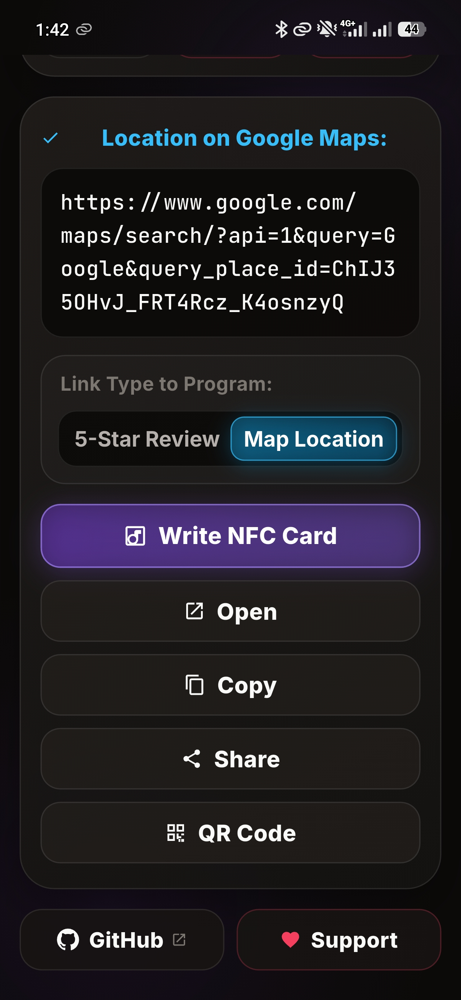
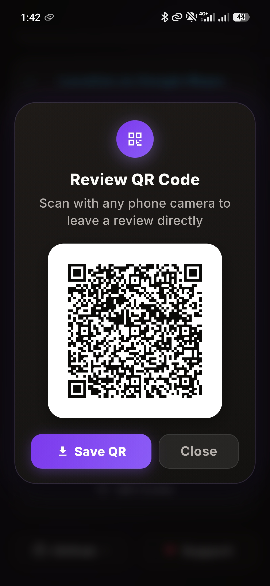
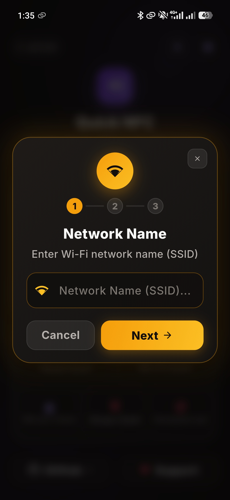
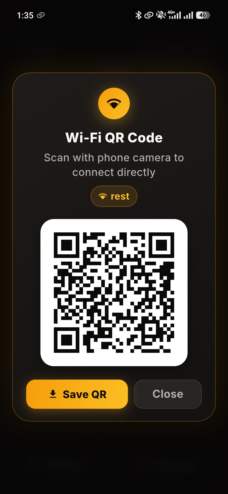

# Quick NFC

**Fast & simple contactless tool for instant Google Maps 5-star reviews, Wi-Fi NFC cards, PIN security, and QR codes.**

 

[**🌐 Open Web App**](https://zaid-a-salameh.github.io/quick-nfc/) • [**📱 Download APK**](https://github.com/zaid-a-salameh/quick-nfc/releases/latest) • [**✨ Report Issue**](https://github.com/zaid-a-salameh/quick-nfc/issues)

---

## 📸 App Showcase

| Dashboard & Direct Links | Review Link & Conversion | Review QR Code |
| :---: | :---: | :---: |
|  |  |  |

| Wi-Fi Card Wizard | Guest Wi-Fi QR Code | PIN Protection | Hardware Lock |
| :---: | :---: | :---: | :---: |
|  |  |  |  |

---

## ✨ Features at a Glance

- ⭐ **Instant 5-Star Reviews**: Converts any Google Maps link or business search into an automated 5-star review submission link (`search.google.com/local/writereview?placeid=...`).
- 📶 **Wi-Fi NFC Cards & Cloning**: Program contactless guest Wi-Fi cards with one tap, or read and duplicate existing cards instantly.
- 📱 **Fast Hardware Writing**: Write URLs, review prompts, or Wi-Fi configurations directly to NFC chips with haptic feedback.
- 🔒 **PIN Lock & Unlock**: Set a 4-digit PIN password to prevent unauthorized overwriting in public venues, with full reversible unlocking.
- 🛡️ **Permanent Hardware Lock**: Lock NFC cards irreversibly into read-only mode for tamper-proof tabletop stands and counters.
- 🔲 **Print-Ready QR Codes**: Generate and save high-resolution PNG QR codes ready for printing on menus, receipts, and stickers.
- 🌍 **10 Native Languages**: Seamless multilingual support with automatic RTL layout for Arabic.
- 📴 **100% Offline & Private**: Zero tracking, no ads, no subscriptions, and no cloud accounts required.

---

## 🏷️ Supported NFC Chips

Works with all standard **NFC Forum Type 2** tags:
- **NTAG213** (144 bytes)
- **NTAG215** (504 bytes)
- **NTAG216** (888 bytes)
- Compatible NFC PVC cards, epoxy stickers, coins, and smart business cards.

---

## 🌍 10 Languages Supported

| Code | Language | Native Name | Direction |
| :---: | :--- | :--- | :---: |
| `en` | English | English | LTR |
| `ar` | Arabic | العربية | RTL |
| `de` | German | Deutsch | LTR |
| `es` | Spanish | Español | LTR |
| `fr` | French | Français | LTR |
| `hi` | Hindi | हिन्दी | LTR |
| `ja` | Japanese | 日本語 | LTR |
| `pt` | Portuguese | Português | LTR |
| `ru` | Russian | Русский | LTR |
| `zh` | Chinese Simplified | 简体中文 | LTR |

---

## 🚀 Quick Start

### 1. Web Application
Use instantly in any browser without installation:  
👉 **[zaid-a-salameh.github.io/quick-nfc](https://zaid-a-salameh.github.io/quick-nfc/)**

### 2. Android App (APK)
1. Download **[Quick NFC APK](https://github.com/zaid-a-salameh/quick-nfc/releases/latest)**.
2. Install on any device running **Android 7.0+ (API 24+)**.
3. Tap NFC cards to write, clone Wi-Fi, or apply security locks.

---

## 🛠️ Tech Stack

- **Mobile**: [Flutter](https://flutter.dev) (Dart 3, clean architecture, native NFC channel bridge).
- **Web**: Vanilla HTML5, modern modular CSS3, and ES6+ JavaScript (zero external framework bloat).
- **Deployment**: GitHub Pages automated pipeline with offline-first PWA caching.

---

## 📄 License

This project is licensed under the **MIT License** — free for personal and commercial use.  
Developed by [Zaid Salameh](https://github.com/zaid-a-salameh).
