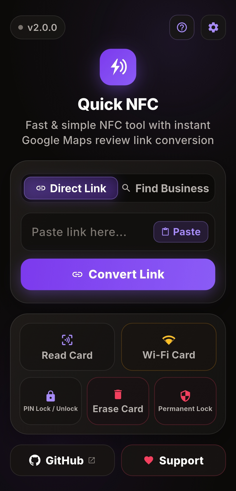
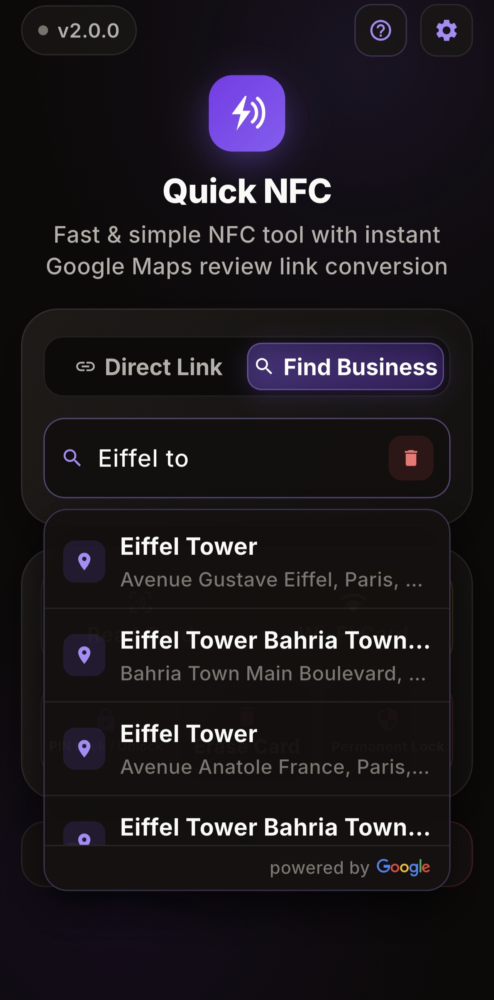
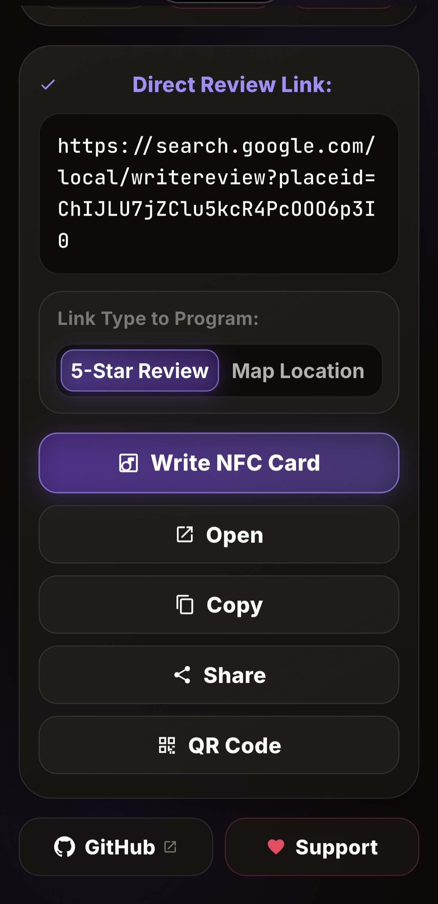
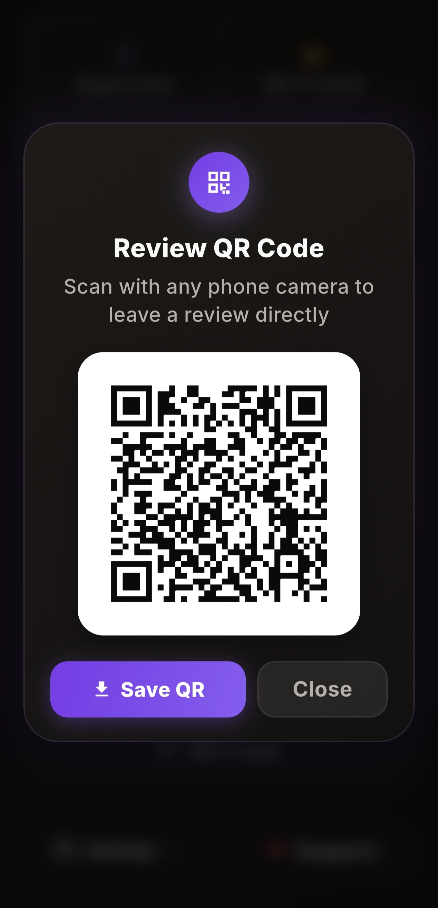
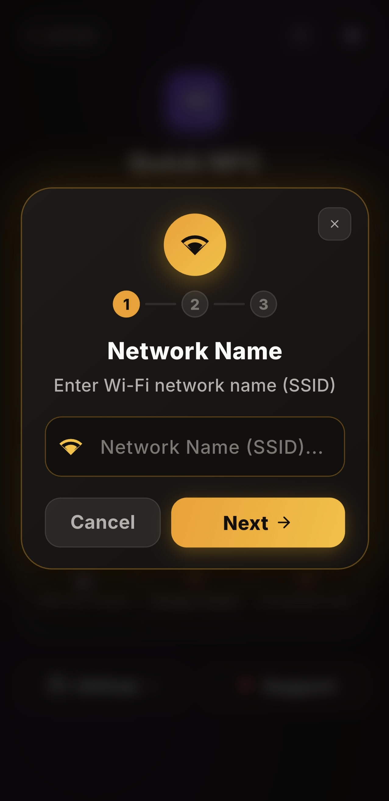
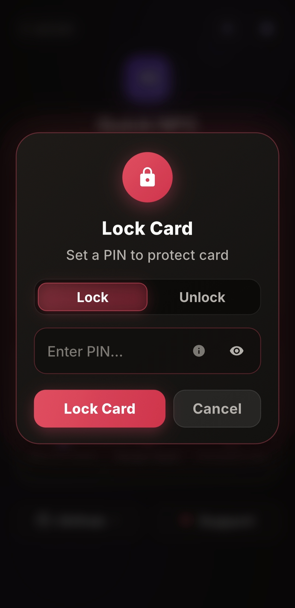
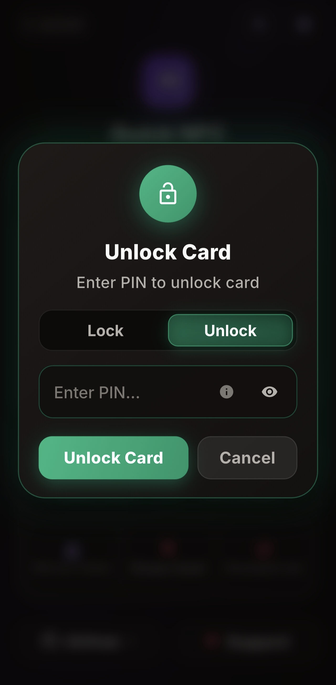
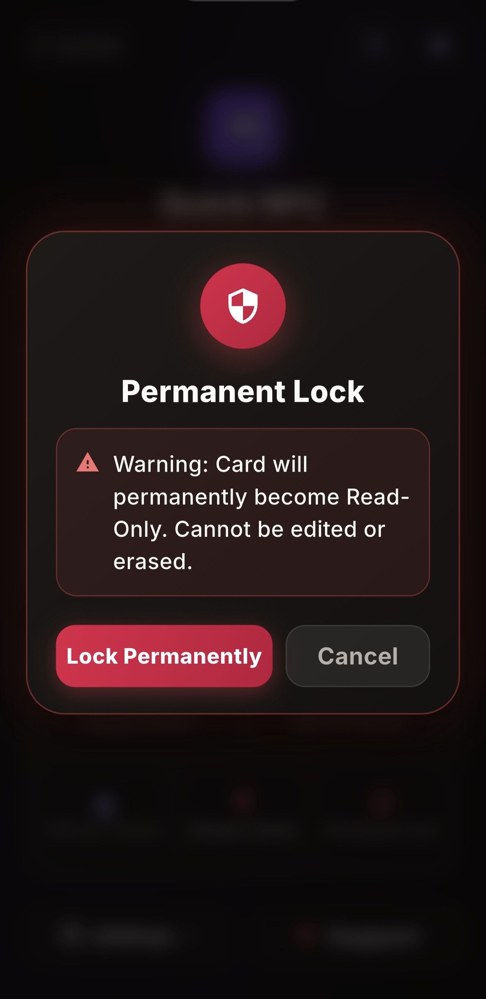

# Quick NFC

**Fast, lightweight, and open-source contactless NFC tool with instant Google Reviews setup, Wi-Fi card encoding, PIN hardware security, and printable QR codes.**

 

[**🌐 Open Web App**](https://zaid-a-salameh.github.io/quick-nfc/) • [**📱 Download APK**](https://github.com/zaid-a-salameh/quick-nfc/releases/latest) • [**✨ Report Issue**](https://github.com/zaid-a-salameh/quick-nfc/issues)

---

## 💡 About Quick NFC

Quick NFC is an open-source Android tool and companion web application built to be the simplest, fastest, and most reliable contactless NFC utility for real-world field work.

### Why Quick NFC?
Instead of bloated commercial suites with paywalls, subscriptions, or intrusive ads, Quick NFC focuses on delivering essential contactless features with zero friction:

* **The Core Problem**: Setting up Google review cards, tabletop stands, and contactless markers usually requires jumping between multiple websites and apps just to extract a Place ID, construct the 5-star URL, generate a QR code, and encode the physical tag.
* **The Unified Solution**: Quick NFC consolidates this entire pipeline into a single, instant workflow: take any Google Maps link or place name, extract the Place ID, generate a direct 5-star review URL and print-ready QR code, and write it directly to an NFC card on the spot.
* **Universal Contactless Utility**: Beyond Google reviews, Quick NFC is a versatile daily NFC utility for writing any web link, encoding guest Wi-Fi cards, setting 32-bit PIN security locks, permanent hardware write-protection, and erasing tags.

---

## 📸 App Showcase

| Dashboard & Direct Links | Google Places Search | 5-Star Review Conversion | Review QR Code |
| :---: | :---: | :---: | :---: |
|  |  |  |  |

| Wi-Fi Card Wizard | PIN Protection (Lock) | Reversible PIN Unlock | Permanent Hardware Lock |
| :---: | :---: | :---: | :---: |
|  |  |  |  |

---

## ✨ Core Features

### 🌟 Dedicated Google Reviews Workflow
- **Instant 5-Star Conversion**: Resolves any Google Maps shortlink, desktop URL, or business search query into a direct Place ID URL (`search.google.com/local/writereview?placeid=...`) that automatically pops open the 5-star rating dialog.
- **Places Autocomplete**: Built-in instant place lookup powered by Google Places API (no API key required on the user side).
- **Print-Ready QR Codes**: Generates clean, high-resolution PNG QR codes ready for printing on table tents, counter stickers, receipts, and marketing stands.

### 📶 General NFC Card Management
- **Universal Tag Writing**: Write review URLs, websites, audio/video media links (YouTube, Spotify, podcasts), or custom URIs to standard NTAG chips with one tap and haptic confirmation.
- **Wi-Fi NFC Cards & Cloning**: 3-step wizard to encode guest Wi-Fi credentials with automated QR fallback, or read and clone existing Wi-Fi cards in seconds.
- **32-Bit PIN Protection**: Set a 4-digit PIN password on supported NTAG chips to prevent unauthorized overwriting in public venues, with full reversible unlocking support.
- **Permanent Hardware Lock**: Irreversibly locks tags into Read-Only hardware mode for tamper-proof public displays and storefronts.
- **Tag Sanitizer**: Quick erase feature to wipe existing payloads and factory-format tags for reuse.

### 🛡️ Privacy & Simplicity First
- **100% Account-Free**: No sign-ups, no logins, no cloud tracking, and no subscriptions.
- **Offline-First**: Core NFC encoding, decoding, PIN locking, and QR code generation operate completely offline.
- **Zero Ads**: Free, clean, and open-source under the MIT license.

---

## 🏷️ Supported NFC Chips

Works with all standard **NFC Forum Type 2** tags:
- **NTAG213** (144 bytes user memory)
- **NTAG215** (504 bytes user memory)
- **NTAG216** (888 bytes user memory)
- Standard NFC PVC cards, epoxy stickers, anti-metal coins, and smart business cards.

---

## 🌐 10 Languages Supported

Quick NFC provides native localization across 10 languages with automatic RTL (Right-to-Left) layout mirroring for Arabic:

| Code | Language | Native Name | Direction |
| :---: | :--- | :--- | :---: |
| `en` | English | English | LTR |
| `ar` | Arabic | العربية | RTL |
| `de` | German | Deutsch | LTR |
| `es` | Spanish | Español | LTR |
| `fr` | French | Français | LTR |
| `hi` | Hindi | हिन्दी | LTR |
| `ja` | Japanese | 日本語 | LTR |
| `pt` | Portuguese | Português | LTR |
| `ru` | Russian | Русский | LTR |
| `zh` | Chinese Simplified | 简体中文 | LTR |

---

## 🚀 Quick Start

### 1. Android Application (APK)
1. Download the latest **[Quick NFC APK](https://github.com/zaid-a-salameh/quick-nfc/releases/latest)**.
2. Install on any device running **Android 7.0+ (API 24+)**.
3. Launch the app and hold any NFC card near your phone to write, secure, or read tags.

### 2. Web Companion
Test links and generate printable QR codes directly from any desktop or mobile browser without installation:  
👉 **[zaid-a-salameh.github.io/quick-nfc](https://zaid-a-salameh.github.io/quick-nfc/)**

---

## 🛠️ Architecture & Tech Stack

- **Mobile App**: Built with [Flutter](https://flutter.dev) (Dart 3), following clean layered architecture with a native Kotlin channel bridge for low-level NFC Transceive operations (NfcA/MifareUltralight, NTAG GET_VERSION, raw 0xA2 page writes, and WSC Wi-Fi parsing).
- **Web App**: Vanilla HTML5, modern modular CSS3, and ES6+ JavaScript with zero external frameworks, featuring instant client-side QR generation and Google Places integration.
- **CI/CD & Deployment**: GitHub Pages pipeline for the web app, and official signed release builds via Gradle.

---

## 📄 License

This project is licensed under the **MIT License** — free for personal, commercial, and educational use.  
Developed with passion by [Zaid Salameh](https://github.com/zaid-a-salameh).
